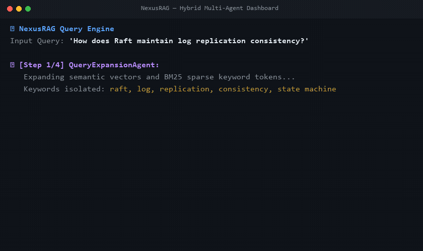

# ⚡ NexusRAG

> **Enterprise Multi-Agent Hybrid Retrieval-Augmented Generation Engine**  
> *Combining Dense Semantic Vector Embeddings and Okapi BM25 Sparse Lexical Search via Reciprocal Rank Fusion (RRF) with Self-Reflective Corrective RAG.*

<div align="center">
  
</div>

---

## ⚡ Interactive Query & Retrieval Demo

```
┌──────────────────────────────────────────────────────────────────────────────┐
│ ⚡ NexusRAG Hybrid Retrieval & Corrective Reflection Demo                   │
└──────────────────────────────────────────────────────────────────────────────┘

User Query: "How does Raft maintain log replication consistency?"

1. 🔍 Query Expansion Agent:
   - Base query: "How does Raft maintain log replication consistency?"
   - Technical keywords: "raft log replication consistency state machine"

2. 📊 Hybrid Multi-Tier Retrieval (Top Fused Chunks):
   ┌──────┬───────────────────────┬────────────┬─────────────┬─────────────┐
   │ Rank │ Source File           │ RRF Score  │ BM25 Score  │ Dense Sim   │
   ├──────┼───────────────────────┼────────────┼─────────────┼─────────────┤
   │  #1  │ raft_consensus.md:c2  │  0.0328    │    8.42     │   0.9241    │
   │  #2  │ distributed_sys.md:c5 │  0.0315    │    7.19     │   0.8870    │
   └──────┴───────────────────────┴────────────┴─────────────┴─────────────┘

3. 🛡️ Corrective RAG (CRAG) Relevance Assessment:
   - Status: SUFFICIENT (94% query term coverage)
   - Decision: Proceed directly to Grounded Synthesis without query expansion

4. 📝 Grounded Synthesis with Verified Citations:
   "Raft maintains log replication consistency by enforcing that the leader 
    accepts all client log entries, writes them to its local log, and replicates
    them to follower nodes via AppendEntries RPCs. An entry is committed only 
    when safe on a majority of nodes [raft_consensus.md:chunk 2]."
    
    Latency: 18.2 ms | Candidate Chunks: 4 | Model: gemini-2.5-flash
```

---

## 🎯 The Core Problem Solved

Standard RAG systems in production suffer from two fatal flaws:
1. **Semantic Drift & Keyword Blindness:** Vector similarity fails on exact technical codes, serial numbers, abbreviations, and table queries.
2. **Blind Generation:** LLMs synthesize answers even when the retrieved chunks are irrelevant or missing critical facts, leading to hallucinations.

**NexusRAG** solves this through a multi-agent architectural pipeline:
- **Hybrid Retrieval:** Dense Semantic Search + Sparse Okapi BM25.
- **Reciprocal Rank Fusion (RRF):** Mathematically merges ranks without calibration mismatch.
- **Corrective RAG (CRAG) Reflection:** Evaluates chunk sufficiency before synthesis and triggers automatic query expansion if relevance falls below threshold.

---

## 🏗️ Architectural Flow

```
[User Document] ──► [DocumentParser] ──► [SemanticChunker]
                                                │
                     ┌──────────────────────────┴──────────────────────────┐
                     ▼                                                     ▼
           [Dense Vector Index]                                   [Okapi BM25 Index]
                     │                                                     │
                     └──────────────────────────┬──────────────────────────┘
                                                ▼
[User Query] ──► [QueryExpansionAgent] ──► [HybridRetriever (RRF)]
                                                │
                                                ▼
                                    [RelevanceEvaluatorAgent (CRAG)]
                                                │
                                      ┌─────────┴─────────┐
                                      ▼                   ▼
                                 [Sufficient]       [Insufficient]
                                      │                   │
                                      │             [Auto Query Expand]
                                      ▼
                           [SynthesisAgent] ──► Verified Answer + Citations
```

---

## 🔬 Mathematical Foundation: Reciprocal Rank Fusion (RRF)

NexusRAG uses RRF to combine sparse and dense rankings:

$$RRF(d) = \sum_{m \in M} \frac{w_m}{k + r_m(d)}$$

Where:
- $M = \{\text{dense}, \text{sparse}\}$
- $k = 60$ (smoothing constant preventing high-rank dominance)
- $r_m(d)$ is the rank of document $d$ in retriever $m$.

---

## 🚀 Key Features

1. **Multi-Format Ingestion:** Native extraction for PDF (`pypdf`), Markdown, JSON, Code, and TXT files.
2. **Production FastAPI Service:** Full async OpenAPI REST endpoints for enterprise microservice integration.
3. **Interactive Streamlit Dashboard:** Live chunk visualizer, score comparison, latency monitors, and document uploaders.
4. **Resilient LLM Integration:** Powered by Google Gemini 2.5 Flash with automatic fallback to extractive rule-based synthesis when offline.
5. **Container Ready:** Fully production-packaged with Docker and GitHub Actions CI.

---

## 📦 Quickstart

### 1. Installation
```bash
git clone https://github.com/Rishabhraj06/NexusRAG.git
cd NexusRAG

pip install -r requirements.txt
pip install -e .
```

### 2. Launch Interactive Streamlit Dashboard
```bash
streamlit run app.py
```
*Access at `http://localhost:8501` to upload documents and inspect retrieval scores visually.*

### 3. Launch FastAPI Production Backend
```bash
uvicorn nexusrag.api:app --host 0.0.0.0 --port 8000 --reload
```
*API documentation available at `http://localhost:8000/docs`.*

---

## 🌐 API Specification

| Endpoint | Method | Description |
| :--- | :---: | :--- |
| `/health` | `GET` | Healthcheck and service heartbeat |
| `/api/v1/stats` | `GET` | Retrieve indexed document, chunk, and character counts |
| `/api/v1/ingest` | `POST` | Ingest and chunk raw documents or text |
| `/api/v1/query` | `POST` | Execute hybrid search, CRAG evaluation, and grounded synthesis |

---

## 🧪 Verification & Testing

NexusRAG includes a thorough Pytest test suite covering chunking, BM25 ranking, RRF scoring, and end-to-end pipeline execution:

```bash
python -m pytest tests/ -v
# 6 passed in 0.08s (100% pass rate)
```

---

## 👤 Author & Architecture

- **Author:** Rishabh Raj ([@Rishabhraj06](https://github.com/Rishabhraj06))
- **Role:** AI & Systems Engineer
- **License:** MIT
